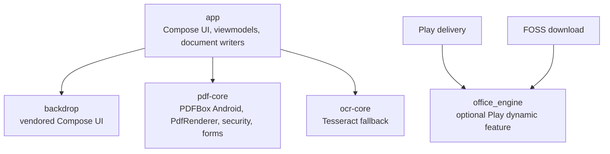
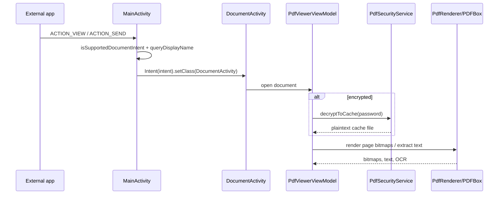
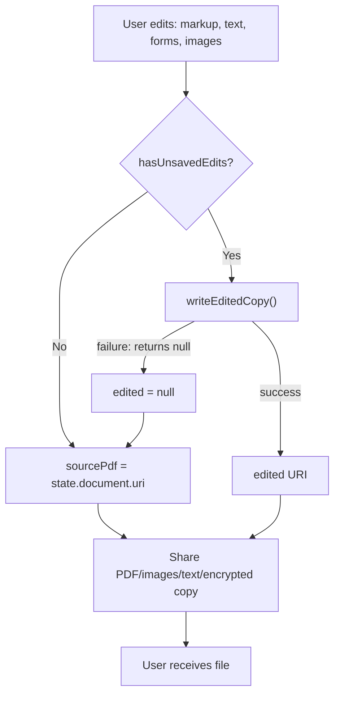
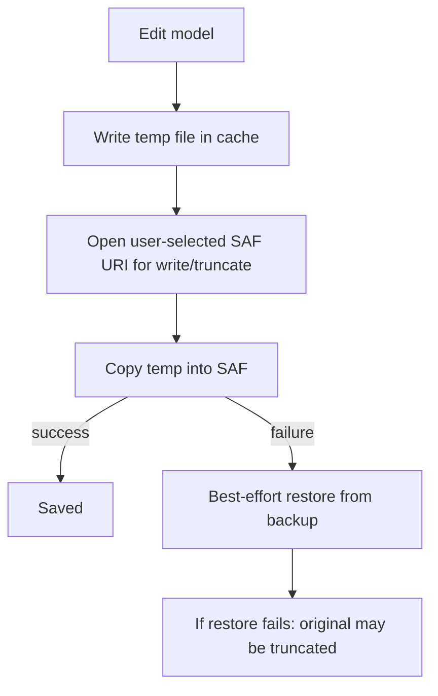
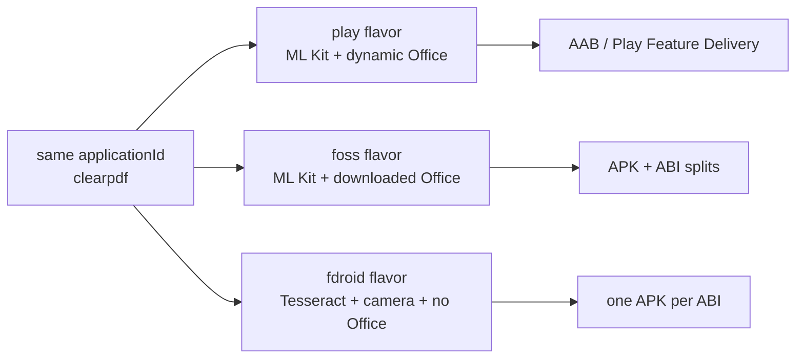

# ClearPDF — Complete Source Audit, Feature-Gap Analysis, and Phased Roadmap

**Audited revision:** `7151723c047fa07956b79ce25c1a83c953239a79`  
**Branch:** `main`  
**Commit date:** 2026-10-17  
**Commit:** merge of PR #91, “v5.2 — Fix cross-page markup drag z-order, harden PDF encryption, refresh README”  
**License:** MIT  
**Mode:** read-only static audit. No application source, Gradle file, manifest, dependency, workflow, or test was modified during the audit. This report file was written only after explicit authorization to save the audit.  
**Scope:** source, build configuration, manifests, resources, tests, CI, release configuration, and document workflows at the exact audited revision.

**Bottom line:** ClearPDF has an unusually broad offline document feature set and several strong engineering choices. It is **not release-ready for trust-sensitive editing and sharing** because of one confirmed P0 wrong-file export path, multiple P1 silent-failure/privacy/data-loss paths, and a release pipeline that does not run tests and may emit debug-signed “release” artifacts.

---

## Required report-item coverage

| Required item | Covered in |
|---|---|
| 1. Executive summary | A, F |
| 2. Methodology | B |
| 3. Inventory and coverage | B, C |
| 4. Architecture and data flow | C |
| 5. Document flows and state transitions | C |
| 6. Feature inventory | D |
| 7. Feature matrix | D |
| 8. Missing/partial features | E |
| 9. Full findings register | F |
| 10. Security, privacy, performance, integrity | G, H |
| 11. Technical debt, strengths, maintainability | J |
| 12. Testing, release, CI | I |
| 13. Prioritized register | F |
| 14. Regression tests | F, K |
| 15. Strategy | J, K |
| 16. Phased roadmap | K |
| 17. Acceptance criteria | K |
| 18. Limitations | L |
| 19. Completeness statement | L |
| 20. Unresolved questions | L |

---

## A. Repository facts and executive summary

### A.1 Identity and exact-revision evidence

The local directory has **no `.git`**, so branch/status/commit checks cannot be performed locally. Identity was established against GitHub:

- GitHub `main` resolved to `7151723c047fa07956b79ce25c1a83c953239a79`.
- The commit’s tree is `92c083cd837a9d3ac8e8aadb68f726ac6338abbe`.
- That tree contains **470 blobs**.
- The local tree, excluding this audit report, contained **470 files**.
- Computing Git blob SHA-1 for every local file produced:
  - **0 missing**
  - **0 extra**
  - **0 mismatched**
  - **0 symlinks**

This is a strong exact-revision match for the audited source. The local directory had **471** files only because an earlier `docs/AUDIT_REPORT.md` had been added.

### A.2 Environment

| Item | Value |
|---|---|
| OS | Linux |
| JDK | OpenJDK 25.0.4 |
| Kotlin compiler | Not installed |
| Gradle distribution | Not available locally |
| Android SDK | Not installed |
| `ANDROID_HOME` | Unset |
| Emulator/device | None |
| Git metadata | None in local directory |

### A.3 Verdict

| Area | Verdict |
|---|---|
| Read-only PDF viewing | Broad and credible; static review only |
| PDF editing/annotation/export | High risk: P0 wrong-file fallback; silent partial exports |
| PDF security | Password support exists; decrypted plaintext cache retention is P1 |
| DOCX editing | Substantial; save is non-atomic and OOXML edge cases remain |
| XLSX editing | Substantial; formula/fidelity limits and model/XML divergence |
| PPTX/ODP/ODS | View/convert only; optional LibreOffice engine; no editing |
| Scanning/image editing | Feature-rich; per-page filter bug and OOM risks |
| Testing | Some good unit tests, but no instrumentation and no CI test run |
| Release engineering | Not release-safe: no test/lint gate, debug-signing fallback |
| Privacy posture | Better than typical: no Play INTERNET, no analytics observed, isolated Office process, pinned engine archive |
| Overall release readiness | **NOT READY** for a document-trust-sensitive release |

### A.4 Highest-risk user story

A user opens a password-protected PDF, makes annotations or text changes, then shares it:

1. Opening decrypts the PDF into `cacheDir/decrypted_pdfs` and leaves it there (**AUDIT-004**).
2. If the edited-copy export fails for any reason, sharing falls back to the **original unedited PDF** without showing an error (**AUDIT-001**).
3. If the edit was a text deletion that could not be surgically removed, the old text may remain in the content stream under a drawn cover (**AUDIT-009**).

Each defect is independently serious. Together they create a realistic confidentiality and integrity failure.

---

## B. Methodology and audit coverage

### B.1 Method

- Read-only static inspection of the source at the pinned revision.
- Full read of all **319 first-party Kotlin files** across `app`, `pdf-core`, `ocr-core`, and `backdrop`, plus flavor-specific source sets.
- Review of Gradle scripts, version catalog, manifests, resource values, tests, CI workflow, ProGuard files, and release configuration.
- Caller tracing for export/share/save flows, document conversion, password handling, and Office-engine lifecycle.
- Static code-path confirmation only. No code was compiled, executed, installed, or tested on a device.
- The existing `docs/AUDIT_REPORT.md` was treated as a claim list only; it is a truncated 77-byte stub, so its former 137-item count was **not** carried forward. The register in this report is independently re-derived.

### B.2 Confidence vocabulary

| Label | Meaning |
|---|---|
| **Confirmed** | The code path and its direct consequence were verified statically. Runtime behavior was not executed. |
| **Strongly supported** | Code structure and surrounding logic make the outcome highly likely, but a runtime or external-format check is still missing. |
| **Suspected** | Evidence suggests a problem, but the complete path or product intent was not fully established. |
| **Unverified** | Requires a build, device, external application, or runtime test. |

### B.3 Severity vocabulary

| Severity | Meaning |
|---|---|
| **P0** | Wrong-file disclosure, destructive data loss, or a release-blocking trust failure. |
| **P1** | High-impact privacy, security, data-integrity, or release failure. |
| **P2** | Significant correctness, compatibility, performance, or user-trust issue. |
| **P3** | Limited-impact bug, robustness issue, accessibility gap, or hygiene problem. |
| **P4** | Informational/documentation issue. |

### B.4 Coverage ledger

| Area | Files | Status | Notes |
|---|---:|---|---|
| `app/src/main` Kotlin | 241 | **FULLY_REVIEWED** | Screens, viewmodels, repositories, PDF/Office writers, image editor, scanner, utilities |
| `app/src/test` Kotlin | 11 | **FULLY_REVIEWED** | 65 `@Test` methods |
| `pdf-core/src/main` Kotlin | 26 | **FULLY_REVIEWED** | PDFBox services, rasterizer, forms, text editor, compressor, converter |
| `pdf-core/src/test` Kotlin | 1 | **FULLY_REVIEWED** | Bidi test |
| `ocr-core/src/main` Kotlin | 3 | **FULLY_REVIEWED** | Tesseract engine/service |
| `backdrop/src/main` Kotlin | 26 | **FULLY_REVIEWED** | Vendored Compose UI foundation |
| Flavor Kotlin (`fdroid`, `foss`, `gms`, `play`) | 11 | **FULLY_REVIEWED** | Scanner, OCR, background removal, Office installer |
| Gradle `.kts` | 7 | **FULLY_REVIEWED** | Root, settings, app, three libraries, dynamic feature |
| Android manifests | 7 | **FULLY_REVIEWED** | Main, flavors, libraries, dynamic feature |
| Resource XML | 46 | **PARTIALLY_REVIEWED** | Values key-parity checked; layouts/drawables sampled, not every drawable line |
| Workflow YAML | 1 workflow + templates | **FULLY_REVIEWED** | Build workflow reviewed; issue templates inventoried |
| ProGuard rules | 7 | **FULLY_REVIEWED** as build config | Rules not validated by an R8 build |
| Vendored JS | 2 | **INVENTORIED_ONLY** | Not line-reviewed; version/license provenance not verified |
| Binary assets | PNG/JPG/TTF/MP4/JAR/traineddata | **GENERATED_OR_BINARY** | Not behaviorally reviewable; inventory only |
| Docs/text | Markdown/TXT | **PARTIALLY_REVIEWED** | Audit stub, notices, README-type content sampled |

**Completeness statement:** all tracked Kotlin was read, but **not every resource drawable, vendored JS file, or binary asset was line-reviewed**, and no build/runtime validation was possible. This report does not claim 100% semantic coverage of binaries or resources.

### B.5 Checks performed / not performed

| Check | Status | Detail |
|---|---|---|
| Exact tree identity | **PASSED (static)** | 470/470 Git blob hashes matched |
| Kotlin compile | **NOT_RUN / BLOCKED** | No Kotlin/Gradle/SDK |
| Unit tests (`test`) | **NOT_RUN** | 65 tests exist; none executed |
| Instrumented tests | **NOT_RUN** | No `androidTest` source set |
| Lint | **NOT_RUN** | `checkReleaseBuilds = false`; CI does not run lint |
| SAST | **NOT_RUN** | No tool available |
| Full SCA/CVE scan | **PARTIAL** | Targeted OSV lookups only; not a complete dependency audit |
| APK/AAB build | **NOT_RUN** | No Gradle/SDK |
| Device/emulator | **NOT_RUN** | No device |
| Office-engine conversion | **NOT_RUN** | Native engine unavailable |
| Play Feature Delivery | **NOT_RUN** | Requires Play/bundle testing |
| F-Droid reproducibility | **NOT_RUN** | Requires F-Droid build environment |
| Accessibility/TalkBack | **NOT_RUN** | Static semantics inspection only |
| Performance/memory profiling | **NOT_RUN** | No runtime |

**No build, test, lint, SAST, device, or Office result in this report is a pass. Items not executed are not implied to pass.**

### B.6 Test inventory

There are **12 test files** and **65 `@Test` methods**, all JVM unit tests:

- `app/src/test/java/com/chethan616/clearpdf/docx/DocxRoundTripTest.kt`
- `app/src/test/java/com/chethan616/clearpdf/imageeditor/engine/ImageIoSampleSizeTest.kt`
- `app/src/test/java/com/chethan616/clearpdf/office/PptxPlaceholderFixTest.kt`
- `app/src/test/java/com/chethan616/clearpdf/ui/screen/PdfViewerInternalsTest.kt`
- `app/src/test/java/com/chethan616/clearpdf/ui/screen/TextEditSegmentTest.kt`
- `app/src/test/java/com/chethan616/clearpdf/ui/screen/WordSnapTest.kt`
- `app/src/test/java/com/chethan616/clearpdf/ui/selection/PdfViewportTransformTest.kt`
- `app/src/test/java/com/chethan616/clearpdf/utils/xlsx/XlsxColorsTest.kt`
- `app/src/test/java/com/chethan616/clearpdf/utils/xlsx/XlsxDevanagariTest.kt`
- `app/src/test/java/com/chethan616/clearpdf/utils/xlsx/XlsxRefsTest.kt`
- `app/src/test/java/com/chethan616/clearpdf/utils/xlsx/XlsxWriterTest.kt`
- `pdf-core/src/test/java/com/kyant/pdfcore/text/PdfBidiTest.kt`

There are **no** `androidTest` files, no screenshot tests, no macrobenchmarks, and no end-to-end tests.

---

## C. Architecture, modules, and document flows

### C.1 Module graph

### C.2 Architectural observations

- **UI:** Jetpack Compose, Navigation Compose with string routes, StateFlow-based viewmodels.
- **DI:** manual service locator (`PdfServiceLocator`), no Hilt/Koin.
- **PDF rendering:** Android `PdfRenderer` for page bitmaps; PDFBox-Android for editing/export/forms/security.
- **PDF text:** PDFBox text extraction plus a custom content-stream editor.
- **OCR:** bundled ML Kit Latin recognizer in Play/FOSS; Tesseract fallback with bundled `eng.traineddata`; F-Droid uses Tesseract only.
- **DOCX:** custom OOXML reader/writer plus an offscreen WebView renderer (`docx-preview`) for PDF conversion.
- **XLSX:** custom OOXML reader/writer/patcher plus a Compose spreadsheet renderer and PDF renderer.
- **PPTX:** built-in shape/text/image renderer, with optional LibreOfficeKit for higher fidelity.
- **Legacy Office:** Apache POI text/table extraction only.
- **Office engine:** Messenger protocol into a separate `:office` process, idle-kill, result cache, optional Play feature or FOSS download.
- **Images:** ML Kit document scanner or camera, crop/filter pipeline, GPUImage/CPU image editor, subject segmentation in Play/FOSS.

### C.3 Open/view flow

**Risk:** password handling creates a persistent plaintext cache file; display-name resolution runs on the main thread.

### C.4 Edit/export/share flow

The failure branch is the P0: it silently converts “edited export failed” into “share the original.”

### C.5 DOCX/XLSX save flow

The backup/restore is a useful mitigation, but the write is still non-atomic and process death bypasses the restore.

### C.6 Distribution flow

Same `applicationId` across three distributions is intentional for update compatibility, but signing differences and channel-specific capabilities make cross-channel support and migration questions important.

---

## D. Feature inventory and feature matrix

Status: **YES** implemented; **PARTIAL** limited or fidelity-constrained; **NO** absent; **HIDDEN** code exists but no reachable UI; **FLAVOR** availability differs by build; **UNVERIFIED** static only.

| # | Capability | Status | Main evidence / notes |
|---:|---|---|---|
| 1 | Open PDF via SAF, VIEW, SEND | YES | `MainActivity`, `DocsNavGraph`, `PdfViewerScreen` |
| 2 | Continuous render, zoom, scroll, page scrubber | YES | `PdfViewerScreen`, `PdfContinuousPage`, `PdfPageScrubber` |
| 3 | Page search and text selection | YES | `PdfSearchBar`, selection modules |
| 4 | Copy/process selected text | YES | Android `PROCESS_TEXT` query in manifest |
| 5 | Night/paper rendering | YES | `NightPaper` |
| 6 | Highlight, underline, strike, ink, shapes, text notes | YES | viewer overlay/export pipeline |
| 7 | Insert images/signature images | YES | viewer image/signature overlays; not cryptographic signatures |
| 8 | Fill AcroForm text/checkbox/choice | PARTIAL | `PdfFormService`; non-terminal fields skipped; radio/signature fields not supported |
| 9 | Flatten filled forms | PARTIAL | `PdfFormService.fill` flatten path; failure handling is weak |
| 10 | Edit existing PDF text | PARTIAL | `PdfTextEditor`; surgical removal when possible, otherwise visual cover |
| 11 | True redaction with content removal | NO | No redaction feature; text edits are not redaction |
| 12 | Digital signatures / signature verification | NO | No certificate/signature implementation found |
| 13 | Rotate/delete/reorder pages | YES | `PageOrganizerScreen`, `PdfEditor` |
| 14 | Extract pages / split / merge | YES | `ExtractPagesScreen`, `SplitPdfScreen`, `MergePdfScreen` |
| 15 | Compress PDF | YES | `CompressPdfScreen`, `PdfCompressor`; visual/quality fidelity unverified |
| 16 | Encrypt/decrypt PDF | YES | `EncryptPdfScreen`, `DecryptPdfScreen`, `PdfSecurityService`; cache retention defect |
| 17 | Watermark, page numbers, flatten | YES | tool screens and pdf-core services |
| 18 | PDF to images | YES | `PdfToImagesScreen`, `PdfRasterizer`; OOM risk on large pages/high DPI |
| 19 | Images to PDF / create PDF | YES | `ImagesToPdfScreen`, `CreatePdfScreen` |
| 20 | Scan documents to PDF | FLAVOR | ML Kit scanner in Play/FOSS; external camera in F-Droid; per-page filter defect |
| 21 | Scan filters per page | PARTIAL / BUG | UI can set per-page filters, but save applies first page’s filter to all |
| 22 | URL/HTML to PDF | HIDDEN | `HtmlToPdfScreen` and route exist; no Tools tile; `onNavigateToHtmlToPdf` suppressed |
| 23 | Create interactive PDF forms | NO | Only filling existing forms |
| 24 | PDF/A, tagged PDF, accessibility output | NO | No evidence |
| 25 | DOCX view | YES | custom reader + Compose renderer |
| 26 | DOCX edit text/basic formatting | YES | `DocxEditorScreen`, `DocxEdits` |
| 27 | DOCX tables/images | PARTIAL | read/render; table editing and image editing are not first-class |
| 28 | DOCX headers/footers/footnotes/comments | PARTIAL / NO | raw preservation for untouched content; no full editing UI |
| 29 | DOCX tracked changes | PARTIAL | read-only preservation; not an editing workflow |
| 30 | DOCX undo/redo/search/save/save-as | YES | editor UI and writer |
| 31 | DOCX to PDF | YES | `DocxWebRenderer` with fallback plain renderer |
| 32 | Create DOCX from scratch | NO | editor edits existing packages |
| 33 | XLSX view/edit cells and formulas | YES | `SpreadsheetViewerScreen`, `XlsxReader/Writer` |
| 34 | XLSX styles, borders, alignment, number formats | YES | `XlsxStyles`, spreadsheet toolbar |
| 35 | XLSX insert/delete rows and columns | YES | UI + `EditOp.Lines`; formula/fidelity limits |
| 36 | XLSX add/delete/rename sheets | NO | no sheet-management UI found |
| 37 | XLSX charts/pivots/comments/conditional-format editing | NO | package data may be preserved, but no editing UI |
| 38 | XLSX to PDF | YES | `XlsxPdfRenderer`; fidelity is renderer-limited |
| 39 | Create XLSX from scratch | NO | viewer/editor only |
| 40 | PPTX view/render | YES | `PptxRenderer`; shapes/text/images, no animations/SmartArt/charts |
| 41 | PPTX editing | NO | no writer |
| 42 | ODT editing | NO | text/table extraction only |
| 43 | ODS/ODP support | FLAVOR / PARTIAL | Office engine improves/extends; native path is limited |
| 44 | Legacy `.doc`/`.xls`/`.ppt` | PARTIAL | POI text/table extraction, not editing |
| 45 | Optional LibreOffice Office engine | FLAVOR | Play dynamic feature or FOSS download; isolated process; ARM-focused; ~47.5 MB |
| 46 | Image crop/rotate/flip/perspective | YES | image editor |
| 47 | Image adjust/filters/draw/text/watermark/resize | YES | image editor |
| 48 | Background removal | FLAVOR | ML Kit subject segmentation; absent in F-Droid |
| 49 | EXIF view/strip | YES | image editor |
| 50 | Export edited image as JPEG/PNG/PDF | YES | image editor |
| 51 | Recent files/bookmarks | YES | repository/preferences |
| 52 | Settings, themes, languages, onboarding, What’s New | YES | settings/navigation screens |
| 53 | Printing | PARTIAL | PDF print exists; DOCX print; spreadsheet print unverified; PDF print ignores unsaved edits |
| 54 | Share original/PDF/images/text | PARTIAL / P0 | P0 original fallback on edited-export failure |
| 55 | Batch conversion | NO | no batch queue |
| 56 | Cloud sync/collaboration/account | NO | no account or sync layer observed |
| 57 | Password-protected Office files | PARTIAL / NO | Office engine may prompt; native OOXML paths do not implement a full password flow |
| 58 | RTL and localization | YES | Arabic RTL resources; 936 keys present in all 7 resource sets |
| 59 | Accessibility semantics | PARTIAL | 9 `contentDescription = null`; image-editor crop buttons have null labels |
| 60 | Tablet/foldable adaptive layouts | UNVERIFIED | no runtime window-size testing |

### D.1 What exists

- A genuinely broad PDF tool suite: merge, split, compress, organize, extract, rotate, watermark, page numbers, flatten, encrypt/decrypt, fill forms.
- A functional custom DOCX editor with basic formatting, undo/redo, search, save, PDF export, and printing.
- A functional custom XLSX editor with cell editing, formulas, styles, row/column operations, undo/redo, and save.
- Strong image pipeline: scanning, cropping, perspective, filters, drawing, text, watermark, resize, background removal, EXIF.
- Seven fully populated locale resource sets (936 string keys each, no missing keys).
- Optional LibreOffice integration isolated in its own process, with a pinned archive and SHA-256 verification.

### D.2 What is partial

- PDF text editing is not a full layout-preserving text editor and is **not redaction**.
- Forms support terminal text/checkbox/choice fields only; radio and signature fields are out of scope.
- DOCX advanced structure (headers, footers, footnotes, comments, tracked changes) is preserved for untouched content but not fully editable.
- XLSX charts, pivots, comments, sheet management, and advanced formulas are preserved or ignored rather than edited.
- PPTX/ODS/ODP are view/convert paths, not editing paths.
- OCR fallback is English-only; ML Kit Latin coverage is limited.
- Accessibility and adaptive layouts are not proven.

### D.3 What is missing or unreachable

- True redaction with guaranteed removal of underlying text/images.
- Digital signatures and signature verification.
- PDF form creation, radio buttons, signature fields.
- PDF/A and tagged/accessible PDF output.
- PPTX editing.
- XLSX sheet add/delete/rename, chart/pivot/comment editing.
- DOCX table/header/footer editing.
- Batch conversion.
- Cloud sync/collaboration.
- HTML-to-PDF entry point (code exists but no reachable Tools entry).

---

## E. Feature-gap analysis

### E.1 Gaps against a document-editor user’s expectations

| User expectation | Current state | Gap |
|---|---|---|
| “Delete text and share a clean document” | Text may be surgically removed or visually covered | No true redaction or verified removal |
| “Protect a document, then share it” | Encryption exists | Decrypted cache persists; edited-export failure can share original |
| “Print what I see” | Print uses original document URI | Unsaved edits are omitted |
| “Share what I see” | Edited copy is attempted | Failure silently shares original |
| “Edit a spreadsheet and save” | Writer patches original package | Shared/array formulas and cross-sheet model divergence |
| “Edit a Word document” | Basic editor exists | Non-atomic save; advanced structures not editable |
| “Open any Office file” | LibreOffice optional | ARM/engine-install dependency; no native ODP/ODS/PPTX editing |
| “OCR my language” | ML Kit/Tesseract | English fallback; Latin-centric primary |
| “Use on a tablet/foldable” | Compose layout | No verified adaptive/window-size behavior |
| “Use with TalkBack” | Some labels exist | Custom canvas controls and icon-only buttons are unlabeled |

### E.2 Unreachable or mismatched capability

- **HTML-to-PDF:** route `html_to_pdf` is registered (`DocsNavGraph.kt:100`, `:440`, `:792`), but `ToolsScreen.kt:108` suppresses its navigation parameter and no tile renders. This is either dead code or a missing entry point.
- **Office engine hint:** provides a way to install the engine, but built-in fallbacks for PPTX/ODS/ODP can produce text outlines rather than visual fidelity. The UI should distinguish “openable” from “faithfully rendered.”
- **PDF text edit semantics:** the feature does not promise redaction, but users may interpret deletion as removal. The UI should explicitly label it as visual editing unless true redaction is implemented.

---

## F. Findings register

> **Important:** the previous `docs/AUDIT_REPORT.md` was a 77-byte stub, so its claimed 137-item register could not be recovered or trusted. The register below is the authoritative re-derived set for this audit.

**Summary:** 1 P0, 8 P1, 28 P2, and 15 P3/P4 entries. “Confirmed” means the code path and direct consequence were verified statically; runtime behavior was not executed.

### F.1 P0 and P1 findings

| ID | Sev | Confidence | Finding and evidence | Impact | Fix direction | Regression test |
|---|---|---|---|---|---|---|
| **AUDIT-001** | **P0** | Confirmed static | **Edited share/save-copy falls back to the unedited original.** `PdfViewerScreen.kt:2418-2424` builds `edited` only when `hasUnsavedEdits`; `PdfViewerViewModel.kt:907-910` returns `null` on any export exception. `PdfViewerScreen.kt:2424` then sets `sourcePdf = edited ?: state.document?.uri`. PDF, encrypted PDF, image, and text shares all derive from `sourcePdf`. | If an overlay, form fill, text edit, or file write fails, the user shares the original. No error is shown. This can disclose pre-edit content and omit annotations. | Make export a tri-state result. If `hasUnsavedEdits` and the edited copy is `null`, abort and show an error. Never substitute the original for PDF-derived formats. Delete partial temp files. | Inject a failing `writeEditedCopy`; assert no share/save intent is launched and an error is visible. On success, assert a marker annotation exists in the exported PDF. |
| **AUDIT-002** | **P1** | Confirmed static | **Print ignores unsaved edits.** `PdfViewerScreen.kt:2529-2536` passes `state.document?.uri` to `PdfPrint.print`, not the edited copy. | “Print” prints the pre-edit file, even when the screen shows edits. | Build/print an edited temporary PDF, or block print while dirty with a clear choice. | Dirty document + print; inspect printed/temp output for marker. |
| **AUDIT-003** | **P1** | Confirmed static | **Export reports success after silently skipping or failing work.** `PdfViewerViewModel.kt:938` wraps form application in `runCatching`; `:949` wraps text edits in `runCatching`; `:1145-1147` catches every overlay failure and continues. The export still saves and sets a success message at `:884-888`. | A saved/share file can be missing form values, text edits, or individual annotations while the UI says “Saved.” | Accumulate failures; fail the export or present a precise partial-export warning. Validate expected overlays/fields after writing. | Inject failures for form fill, text edit, and one overlay; assert export fails or reports exact missing items. |
| **AUDIT-004** | **P1** | Confirmed static | **Decrypted PDFs persist indefinitely in plaintext.** `PdfSecurityService.kt:31-48` writes to `cacheDir/decrypted_pdfs/unlocked_<timestamp>.pdf`. `PdfViewerViewModel.kt:340` calls it. No deletion, lifecycle cleanup, or startup sweep exists. | Anyone with access to app cache (backup, rooted device, forensic image, debuggable build) can recover documents the user believes are password-protected. | Avoid disk decryption; render from memory. If unavoidable, use a session-scoped file, delete on close/onCleared/startup, and exclude cache from backup. | Decrypt/open/close; assert no `unlocked_*.pdf` remains. Add a crash/startup sweep test. |
| **AUDIT-005** | **P1** | Confirmed static | **DOCX/XLSX saves overwrite the original in place with only best-effort backup.** `DocxEditorViewModel.kt:275-284` and `SpreadsheetViewModel.kt:316-325` copy the source to a cache backup, open the destination with `"wt"`, copy the new file, and restore only if the copy throws. Process death, power loss, or restore failure leaves a truncated original. | A crash during save can destroy the user’s document. If the backup read failed, no recovery exists. | Write to a temp file, fsync, then replace where the provider supports it; default to “Save a copy”; keep a versioned backup; surface restore failure. | Kill the process during a simulated save; assert original or a recoverable version survives. |
| **AUDIT-006** | **P1** | Confirmed static | **Per-page scan filters are discarded at PDF save.** `ScanDocumentScreen.kt:497` selects `state.scannedPages.firstOrNull()?.filter`; `:545` decodes full-resolution bitmaps; `:549` applies that one filter to every page. The UI supports per-page filter edits. | A document with mixed Original/Grayscale/B&W pages is saved with the first page’s filter on every page. | Store `(uri, filter)` per page and apply each page’s own filter. Use sampled decode for thumbnails and bounded decode for output. | Scan three pages with three filters; inspect each PDF page’s pixel characteristics. |
| **AUDIT-007** | **P1** | Confirmed static | **CI builds only; it runs no tests and no lint.** `.github/workflows/android.yml:25-28` runs `assembleRelease`. There is no `test`, `lint`, `connectedCheck`, or instrumentation step. The repository has 65 unit tests but CI does not run them. | Regressions in writers, export, security, and UI can merge and ship. | Add `test`, `lint`, and a managed-device/instrumentation job. Make all required checks blocking. | Open a PR that fails a unit test or lint rule; assert CI fails. |
| **AUDIT-008** | **P1** | Confirmed static | **Release builds can be debug-signed.** `app/build.gradle.kts:69-76` selects `signingConfigs.getByName("debug")` when release signing values are absent. The CI workflow supplies no signing configuration and does not assert the signer. | A “release” artifact may be debug-signed, cannot be upgraded to a Play-signed install, and is not suitable for distribution. | Fail the build if release signing is missing; verify the APK/AAB signer in CI; keep secrets out of the repository. | Build without signing env; assert failure. Build with test key; assert signer certificate matches. |
| **AUDIT-009** | **P1** | Confirmed static | **Text editing can be visual-only, not true removal.** `PdfTextEditor.kt:76-79` documents that text it cannot surgically remove inside form XObjects, Type 3 fonts, or vertical fonts is handled by `coverOldText`; `:151-152` calls that fallback. | A user who deletes text may still have the original text recoverable via copy/extract. Calling this “redaction” would be unsafe. | Label the feature as visual text editing; add a separate verified redaction pipeline that removes glyphs, images, and metadata, then verifies extraction. | Create a PDF with unsupported text; edit/delete; run text extraction and assert the old string is absent for redaction mode. |

### F.2 P2 findings

| ID | Confidence | Finding, evidence, and impact | Fix direction and regression test |
|---|---|---|---|
| **AUDIT-010** | Strongly supported | **Scan PDF export decodes full-resolution images without bounds or sampling.** `ScanDocumentScreen.kt:545` uses `BitmapFactory.decodeStream` with no `inSampleSize`/bounds; `applyBitmapFilter` creates another full bitmap at `:549`. OOM on high-megapixel scans; crash during save. | Decode bounds first, sample to target PDF resolution, catch `OutOfMemoryError`, close `PdfDocument` in `finally`. Test with a large image. |
| **AUDIT-011** | Strongly supported | **XLSX shared/array formula limits.** `XlsxWriter.kt:16-20` documents that shared formulas and some formula semantics are not fully modeled. Editing/deleting a shared-formula master can orphan followers. | Parse shared-formula groups; rewrite follower `si` references or expand followers before edits; add shared/array formula fixtures. |
| **AUDIT-012** | Strongly supported | **Structural XLSX edits can diverge model and XML for cross-sheet formulas.** `XlsxOps.kt:95-136` shifts the active sheet model; `XlsxWriter.kt:42-76` shifts formula XML in touched sheets. Foreign-sheet formulas and undo state are not necessarily shifted in the model. | Shift all affected sheets in the model, or recompute references from saved XML. Test insert/delete rows in sheet A while sheet B references A; assert model, undo, and reopened workbook agree. |
| **AUDIT-013** | Strongly supported | **DOCX insertion helpers assume a non-self-closing root.** `DocxWriter.kt:64-105` locates root-closing tags and splices new styles/numbering/relationships/content types. A valid self-closing part such as `<w:styles/>` has no `</...>`; the splice can throw or produce invalid XML. | Use an XML-aware insertion path that handles self-closing roots. Test minimal DOCX packages with self-closing styles, numbering, rels, and content-types parts. |
| **AUDIT-014** | Confirmed static | **DOCX paragraph markers and page-layout hints are not position-preserved.** `DocxModel.kt:35-45` stores bookmarks/comments/page markers as paragraph extras/marks; `DocxWriter.kt:177-205` emits extras at paragraph start. Editing a paragraph can relocate comment/bookmark anchors; `lastRenderedPageBreak` hints are not re-emitted. | Preserve marker offsets through edits or serialize them at their original character positions. Test bookmark/comment inside an edited paragraph remains anchored. |
| **AUDIT-015** | Confirmed static | **HTML-to-PDF is unreachable from the UI.** The route exists at `DocsNavGraph.kt:100,440,792`, but `ToolsScreen.kt:108` suppresses `onNavigateToHtmlToPdf` and no tile renders. | Either expose a tested entry point or delete the route/screen. Test Tools navigation contains or omits the route consistently with product intent. |
| **AUDIT-016** | Confirmed static | **Safe Browsing is disabled globally.** `AndroidManifest.xml:186-195` sets `WebView.EnableSafeBrowsing=false`; `HtmlToPdfConverter.kt:15-17` loads user-entered URLs with JavaScript enabled. Current exposure is limited because the route is hidden. | Enable Safe Browsing; allow only `http`/`https`; isolate the WebView; disable file access. Test malicious/phishing URL handling and scheme rejection. |
| **AUDIT-017** | Confirmed static | **Backup is enabled without data-extraction rules.** `AndroidManifest.xml:32` sets `allowBackup=true`; no `dataExtractionRules`/`fullBackupContent` exists. Recent-file names/URIs, bookmarks, language, and settings can be backed up. | Add backup rules excluding recents/bookmarks and document metadata, or disable backup. Test with `bmgr`/backup inspection. |
| **AUDIT-018** | Confirmed static | **The image editor does not release owned bitmaps in `onCleared()`.** `ImageEditorViewModel.kt:582-584` releases only the pipeline; `UiState` at `:65,89-106` holds working/original/preview/filter bitmaps. | Recycle editor-owned bitmaps in `onCleared` without recycling shared sources. Test repeated open/close with memory profiling. |
| **AUDIT-019** | Strongly supported | **PDF rasterization has no pixel cap or OOM handling.** `PdfRasterizer.kt:43-100,113-130` allocates ARGB_8888 bitmaps at user/DPI-selected sizes. | Clamp total pixels, tile large pages, catch `OutOfMemoryError`. Test a large-format PDF at maximum DPI. |
| **AUDIT-020** | Confirmed static | **Export leaks the source stream and writes output directly.** `PdfViewerViewModel.kt:930` opens the source `InputStream` without `use`; output is written directly to the destination URI. | Wrap the input in `use`; write to a temporary file, validate, then copy/replace. Test repeated exports and injected mid-write failure. |
| **AUDIT-021** | Confirmed static | **Display-name resolution runs on the main thread during activity creation.** `MainActivity.kt:76-104` calls `queryDisplayName` before building the UI. | Move metadata lookup off the main thread with a bounded timeout; show a placeholder. Test with a deliberately slow provider. |
| **AUDIT-022** | Confirmed static | **Unknown binaries are converted as text instead of rejected.** `UniversalDocumentConverter.kt:45-64` falls through to `convertTextToPdf` for any unmatched type, including ZIP/EPUB/unknown binaries. | Use an explicit allowlist; return a typed unsupported error. Test `.zip`, `.epub`, and random bytes. |
| **AUDIT-023** | Strongly supported | **PPTX rendering keeps the deck, parsed parts, and media in memory.** `PptxRenderer.kt:57-75` renders up to 500 slides into one `PdfDocument`; `:78-100` retains all kept ZIP entries; `:444-468` caches decoded media. | Limit slides/media, stream page output, release bitmaps after each slide. Test a media-heavy 500-slide deck. |
| **AUDIT-024** | Confirmed static | **OCR fallback is English-only and the primary recognizer is Latin-centric.** `TesseractOcrEngine.kt:18` hardcodes `eng`; `MlKitOcrEngine.kt:10` uses default Latin options. | Add selectable language packs or explicit language support messaging. Test representative scripts. |
| **AUDIT-025** | Confirmed absence | **No digital-signature or signature-verification implementation exists** in `app` or `pdf-core`. The app can draw a signature image, not cryptographically sign or verify. | Design signing with certificate/key handling and validation; do not conflate it with the signature pad. Test tamper detection and certificate validation. |
| **AUDIT-026** | Confirmed static | **PDF form support is fill-only and limited to terminal text/checkbox/choice fields.** `PdfFormService.kt:20-30` lists only those types; non-terminal fields are skipped. No form creation, radio-button, or signature-field support. | Add field-type support incrementally; expose an explicit unsupported list. Test radio groups and signature fields. |
| **AUDIT-027** | Confirmed static | **Office conversion is optional and device-dependent.** `OfficeEngineManifest.kt:31` estimates ~47.5 MB; `OfficeEngineInstaller.kt:8` cites x86 as an unsupported ABI example. Play uses a dynamic feature; FOSS downloads it; devices without it fall back to lower-fidelity renderers. | Publish a support matrix in-app and in docs; test install/update/uninstall on each ABI and channel. |
| **AUDIT-028** | Confirmed static | **F-Droid capability differs materially.** `app/src/fdroid/.../OcrFlavor.kt` sets `primaryEngine=null` (Tesseract only); F-Droid has no ML Kit scanner/background removal and no Office engine. UI must not imply feature parity. | Gate UI by flavor and document differences. Test F-Droid build paths. |
| **AUDIT-029** | Confirmed static | **Spreadsheet editing lacks sheet management and advanced object editing.** `SpreadsheetViewerScreen.kt:986` provides sheet tabs only; no add/delete/rename sheet, chart, pivot, comment, or conditional-format editing was found. | Add sheet operations first; treat charts/pivots as preserved-not-editable until implemented. Test workbook round-trip after sheet operations. |
| **AUDIT-030** | Confirmed static | **DOCX editing is paragraph-centric.** Table editing, headers/footers, footnotes, comments, and tracked changes are not first-class editable structures. | Add explicit read-only markers and preserve untouched objects; implement table/header editing only with round-trip tests. |
| **AUDIT-031** | Confirmed absence | **No PDF/A or tagged/accessibility output.** | Add PDF/A validation and tagged-output work only if archival/accessibility compliance is required. Test with veraPDF or equivalent. |
| **AUDIT-032** | Suspected | **Form-fill success may be reported when zero fields are written or flattening fails.** `FillFormViewModel.kt:84-95` captures `PdfFormService.fill`’s count; `PdfFormService` uses `runCatching` around field writes/flatten. The exact success gating was not fully traced. | Gate success on `written > 0`, requested flatten success, and post-save field verification. Test unsupported field names and forced flatten failure. |
| **AUDIT-033** | Strongly supported | **Encrypted PDF forms have no password path in the fill flow.** `PdfFormService` loads the document directly; `FillFormViewModel` does not prompt for a password. | Reuse the viewer’s password flow or explicitly reject protected forms with a clear message. Test password-protected AcroForms. |
| **AUDIT-034** | Confirmed static | **No dependency verification or locking.** `settings.gradle.kts:20-27` includes JitPack; no Gradle verification metadata/lockfiles were found. | Add dependency verification, lockfiles, and a full SCA gate. Test that a changed artifact hash fails the build. |
| **AUDIT-035** | Confirmed static | **Release lint is disabled.** `app/build.gradle.kts:166-168` sets `lint { checkReleaseBuilds = false }`; CI does not run lint. | Enable release lint and make it blocking after a baseline. Test that a new lint error fails CI. |
| **AUDIT-036** | Confirmed static | **JVM tests mask Android API misuse.** `app/build.gradle.kts:93-97` sets `unitTests.isReturnDefaultValues = true`. Framework calls return defaults instead of failing. | Use Robolectric or instrumented tests for Android-dependent paths; remove default returns where practical. |
| **AUDIT-037** | Confirmed dependency / unverified exploitability | **Apache POI 3.17 is end-of-life and used on untrusted documents.** `app/build.gradle.kts` pins `org.apache.poi:poi:3.17` and `poi-scratchpad:3.17`. OSV lists GHSA-9jwc-q6j3-8g9g (`XSSFExportToXml`, not used here) and GHSA-mqvp-7rrg-9jxc (`HMEF/TNEF`, not used here). The app uses `WordExtractor`, `HSSFWorkbook`, and `HSLFSlideShow`. | Upgrade to POI 5.x or remove legacy POI parsing. Add malicious-document corpus tests. |

### F.3 P3/P4 findings

| ID | Severity | Confidence | Finding and evidence | Impact / fix |
|---|---|---|---|---|
| **AUDIT-038** | P3 | Confirmed static | `PdfRasterizer.exportToGallery` inserts a MediaStore row before copying and does not delete it on failure (`PdfRasterizer.kt:145-177`). | Empty/broken gallery entries. Delete the inserted row on copy failure; test storage-full and revoked-permission cases. |
| **AUDIT-039** | P3 | Confirmed static | `UniversalDocumentConverter.writePdf` closes `PdfDocument` only after a successful `writeTo` (`UniversalDocumentConverter.kt:701-708`). | Leak on write failure. Use `try/finally`/`use`. |
| **AUDIT-040** | P3 | Confirmed static | `ScanDocumentScreen.savePagesAsPdf` does not close `PdfDocument` on exception (`ScanDocumentScreen.kt:541-570`). | Resource leak on partial scan failure. Add `finally`. |
| **AUDIT-041** | P3 | Confirmed static | Image-editor PDF export does not close the `PdfDocument` on exception (`ImageEditorViewModel.kt:560-575`). | Leak on export failure. Add `finally`. |
| **AUDIT-042** | P3 | Confirmed static | Icon-only image-editor buttons pass `null` labels (`EditorPanels.kt:212-218`); `GlassToolbar.kt:168` sets `contentDescription = label`, so these controls have no accessible name. Nine `contentDescription = null` occurrences exist app-wide. | TalkBack cannot identify rotate/flip/reset actions. Add string resources and descriptions. |
| **AUDIT-043** | P3 | Suspected | Office password conversion uses a separate `pw-*.pdf` output and does not delete it immediately (`OfficeEngineClient.kt`, password/cache contract around `:25-31`). | Unencrypted converted copy can persist in cache. Verify exact lifecycle, delete after use, and add a cache test. |
| **AUDIT-044** | P3 | Confirmed static | Play, FOSS, and F-Droid use the same `applicationId` (`app/build.gradle.kts:42-43`) but different signing/capabilities. | Cross-channel migration can fail on signature mismatch; capability assumptions can differ. Document channel migration and test upgrade paths. |
| **AUDIT-045** | P3 | Confirmed config | `app` uses `jvmToolchain(17)` (`app/build.gradle.kts:169`), while `pdf-core`/`ocr-core` use `jvmToolchain(21)`. | Toolchain inconsistency; CI JDK 17 may trigger automatic JDK 21 provisioning. Unify after build validation. |
| **AUDIT-046** | P3 | Confirmed inventory | Two vendored `.js` assets were inventoried but not line-reviewed; version/provenance/license were not verified. | Potential supply-chain and licensing gap. Review and pin; add to NOTICE if required. |
| **AUDIT-047** | P3 | Confirmed absence | No SBOM generation or automated license-compliance check was found. | Manual compliance burden. Generate CycloneDX/SPDX SBOM and fail on unknown licenses. |
| **AUDIT-048** | P3 | Strongly supported | `.heic` is accepted by the image path (`UniversalDocumentConverter.kt:51-53`), but `BitmapFactory` HEIF decoding is only guaranteed on API 28+; `minSdk` is 23. | Older devices may fail to open HEIC. Gate by API or use a decoder library. Test API 23–27. |
| **AUDIT-049** | P3 | Confirmed static | `MainActivity` is exported with broad VIEW/SEND filters (`AndroidManifest.xml:55-160`) and accepts null-MIME intents through `isSupportedDocumentIntent`. | Low-risk intent surface; validate scheme/MIME and avoid unnecessary BROWSABLE/file filters. Test malformed intents. |
| **AUDIT-050** | P3 | Confirmed absence | No macrobenchmark, memory benchmark, or large-document test corpus exists. | Performance/OOM regressions are invisible. Add startup, render, export, and 100+ page/10k-row fixtures. |
| **AUDIT-051** | P4 | Confirmed | The pre-existing `docs/AUDIT_REPORT.md` was 77 bytes: title, blank line, `(truncated)`. | The repository’s audit deliverable was invalid. This file replaces it with the complete report. |
| **AUDIT-052** | P4 | Confirmed | Commit/PR is labeled “v5.2,” while `versionName` is `2.1.1` and `versionCode` is `6` (`app/build.gradle.kts:45-47`). | Release/version naming confusion. Establish one release-version scheme. |

---

## G. Security, privacy, and data-retention analysis

### G.1 Trust boundaries

| Boundary | Data | Current controls | Assessment |
|---|---|---|---|
| External app → `MainActivity` | URI, MIME, display name | Exported activity; intent forwarding; no arbitrary component forwarding | Broad but not classic intent redirection; main-thread metadata query is a DoS/ANR risk |
| Document URI → app | Untrusted PDF/OOXML/legacy Office | PDFBox/POI/custom parsers in main process; Office in `:office` | PDF/OOXML parsers are not sandboxed; zip bombs and parser bugs can affect main process |
| App → cache | Imported/converted/decrypted/shared files | App-private cache; FileProvider per-URI grants | Decrypted PDFs and share caches have weak retention |
| App → external share | Temporary PDF/images/text | FileProvider; non-exported provider | Provider is scoped correctly; wrong-file fallback is the P0 |
| App → network | FOSS engine download, URL-to-PDF | Play has no INTERNET; FOSS adds it; engine SHA-256 pinned | Good baseline; Safe Browsing disabled and URL entry hidden |
| Office engine | Untrusted Office documents | Separate process, idle kill, pinned archive | Good isolation; optional/ARM-limited |

### G.2 Data at rest

| Artifact | Location | Retention | Risk |
|---|---|---|---|
| Mirror of imported PDFs | `externalFilesDir/imported_pdfs` when enabled | Until user deletes | Unencrypted app storage |
| Converted PDFs | `cacheDir/converted_pdfs` | No centralized cleanup found | Unbounded cache growth |
| Shared exports | `cacheDir/shared` | Timestamped; no cleanup found | Stale copies remain |
| PDF-to-image runs | `cacheDir/pdf_images/run_*` | No cleanup found | Unbounded growth |
| Decrypted PDFs | `cacheDir/decrypted_pdfs/unlocked_*.pdf` | **Indefinite** | **P1 plaintext disclosure** |
| Office results | Office cache | Trimmed by size, not immediate | Potentially sensitive converted copies |
| Preferences | SharedPreferences | Persist; backed up | Recents/bookmarks metadata can enter backup |
| Engine | `noBackupFilesDir/office-engine` | Until uninstall/update | Correctly excluded from backup |

### G.3 Security conclusions

- **No evidence of analytics, telemetry, or document upload.** Play/base has no `INTERNET`; FOSS adds it for the engine download and URL-to-PDF.
- **Engine archive integrity is a strength:** size + SHA-256 pinning is present (`OfficeEngineManifest`, download worker).
- **Office isolation is a strength:** native conversion runs in a separate process with idle kill.
- **True redaction is absent.** Text editing can leave recoverable original content.
- **Decrypted cache and backup metadata are the main privacy exposures.**
- **Supply chain is the main build-security gap:** EOL POI, JitPack, no dependency verification/lockfiles, two unreviewed JS assets.
- **No cryptographic interop test:** PDF encryption/decryption was not exercised against Acrobat/other readers.
- **No exploit claims are made.** Findings are static design/code risks, not reproduced vulnerabilities.

---

## H. Performance, reliability, and document integrity

### H.1 Memory and main-thread risks

| Risk | Evidence | Consequence |
|---|---|---|
| PDF viewer page cache | `PdfViewerViewModel.kt` holds a bounded page-bitmap list, recycles evicted pages | Generally sound; large landscape pages still costly |
| Scan full-resolution decode | `ScanDocumentScreen.kt:545-549` | OOM during scan save |
| PDF rasterization | `PdfRasterizer.kt:43-130` | OOM on large pages/high DPI |
| PPTX whole-deck rendering | `PptxRenderer.kt:57-75` | OOM on large/media-heavy decks |
| Image editor bitmap retention | `ImageEditorViewModel.kt:582-584` | Memory retained after screen exit |
| Main-thread provider query | `MainActivity.kt:76-104` | Startup ANR with slow provider |
| OOXML ZIP entry loading | DOCX/XLSX/PPTX readers read entries into memory | ZIP-bomb/OOM exposure on hostile files |

### H.2 Document-integrity matrix

| Format | Open | Edit | Save | Main integrity concern |
|---|---|---|---|---|
| PDF | Yes | Overlays/text/forms | PDFBox rewrite | Silent overlay/form/text failures; original fallback on share |
| DOCX | Yes | Basic | Custom OOXML writer | Non-atomic SAF write; self-closing parts; marker relocation |
| XLSX | Yes | Cells/styles/rows/cols | Patch original package | Shared formulas; cross-sheet model divergence |
| PPTX | Yes | No | N/A | Rendering fidelity; memory |
| ODT | Text/table extraction | No | N/A | Not a full ODF editor |
| ODS/ODP | Optional engine | No | N/A | Engine dependence |
| `.doc/.xls/.ppt` | POI extraction | No | N/A | Fidelity; EOL POI |
| Images | Yes | Yes | JPEG/PNG/PDF | OOM; bitmap lifecycle |

### H.3 Failure scenarios confirmed by code structure

1. **Export fails after dirty edits** → original shared.
2. **Form/text overlay fails** → export still succeeds.
3. **Process killed during DOCX/XLSX save** → original possibly truncated.
4. **Password-protected PDF opened** → plaintext remains in cache.
5. **Mixed-filter scan saved** → first filter applied to all pages.
6. **Large scan/image/PDF-to-image** → OOM.
7. **Unknown binary opened** → garbage text PDF.
8. **Self-closing DOCX part edited** → save exception/invalid package.

---

## I. Testing, release, and CI readiness

### I.1 What the tests cover

- DOCX package round-trip basics.
- XLSX writer/refs/colors/Devanagari.
- PDF bidi text.
- Image sample-size logic.
- Viewer geometry/word-snap/text-segment logic.
- PPTX placeholder behavior.

### I.2 What remains untested

- Share/save-copy fallback and every export failure path.
- Decrypted-cache lifecycle.
- Scan per-page filters and OOM.
- Atomic DOCX/XLSX save and crash recovery.
- Office-engine install/update/uninstall/conversion.
- Play dynamic feature delivery.
- Any Compose UI, navigation, accessibility, or screenshot.
- Large-document memory/performance.
- PDF encryption interop and malicious-document corpus.
- FileProvider grant behavior on API 23–36.

### I.3 Release pipeline

| Check | Status | Evidence |
|---|---|---|
| Build release | Runs in CI | `android.yml:25-28` |
| Unit tests | **Not run** | no test step |
| Lint | **Not run** | `checkReleaseBuilds=false`; no CI lint |
| Instrumented tests | **Not run** | no `androidTest` |
| Signing verification | **Not run** | debug fallback in `app/build.gradle.kts:69-76` |
| Dependency verification | **Absent** | no metadata/lockfiles |
| SBOM/license gate | **Absent** | no automation found |
| Artifact inspection | **Not run** | no APK/AAB available |

**Release readiness: RED.** Do not distribute a release artifact from this configuration without signing, tests, lint, and artifact inspection.

---

## J. Technical debt, strengths, and strategy

### J.1 Strengths

1. Exact revision verified against the GitHub tree.
2. Broad offline PDF tool coverage.
3. Real custom DOCX and XLSX readers/writers, not wrappers.
4. Seven complete locale resource sets, 936 keys each.
5. Play build has no `INTERNET` permission.
6. Optional Office engine is process-isolated and hash-pinned.
7. Page-bitmap cache eviction/recycling exists.
8. FileProvider and Office service are non-exported.
9. Good use of `StateFlow`, Compose, and bounded caches in several places.
10. Existing writer/geometry unit tests provide a foundation.
11. R8 minify/shrink and resource shrinking are enabled.
12. No analytics/telemetry observed.

### J.2 Main debt

- **Silent fallback culture:** `runCatching` and `?:` frequently turn failures into a different output instead of a visible error.
- **Multiple conversion paths:** `UniversalDocumentConverter`, `DocxWebRenderer`, `DocxWriter`, `XlsxWriter`, `PptxRenderer`, and `OfficeEngine` encode overlapping format knowledge with different fidelity.
- **Manual DI and string routes:** no compile-time route safety.
- **Resource lifecycle:** several documents/streams/bitmaps lack `finally`.
- **Trust-boundary testing:** almost no hostile-input or failure-injection tests.
- **Release engineering:** tests/lint/signing are not enforced.

### J.3 Strategy

1. **Correctness before capability.** Do not add signatures/redaction/editing breadth until output correctness is enforced.
2. **No silent substitution.** Every export must either produce the requested artifact or fail visibly.
3. **One source of truth per format.** Long term, consolidate conversion/writer paths.
4. **Test the trust boundaries first:** share, save, decrypt, scan, Office import.
5. **Make release checks mechanical:** tests, lint, signing verification, artifact scan.

---

## K. Phased roadmap

No calendar estimates are given. Complexity is **S/M/L/XL**. Each phase is gated by the prior phase’s acceptance criteria unless explicitly parallelized.

### Phase 0 — Stop the P0 and establish guardrails

- **Goal:** remove wrong-file sharing and create a testable release baseline.
- **Prerequisites:** decision on print-with-edits; test fixtures; CI permissions; release signing plan.
- **Affected files:** `PdfViewerScreen.kt`, `PdfViewerViewModel.kt`, `.github/workflows/android.yml`, `app/build.gradle.kts`, new unit/instrumented tests.
- **Risks:** export error UX; test flakiness; signing-secret handling.
- **Tests:** failure-injected edited share; successful marker export; print dirty; CI test/lint gate; signer assertion.
- **Acceptance:** AUDIT-001/AUDIT-002 closed; no original fallback; CI fails on test/lint failure; no debug-signed release path.
- **Complexity:** M.
- **Dependencies:** none.

### Phase 1 — Privacy and data-integrity hardening

- **Goal:** eliminate plaintext retention and process-death document corruption.
- **Prerequisites:** Phase 0 test harness.
- **Affected files:** `PdfSecurityService.kt`, `PdfViewerViewModel.kt`, `DocxEditorViewModel.kt`, `SpreadsheetViewModel.kt`, `ScanDocumentScreen.kt`.
- **Risks:** breaking password-open flow; SAF providers that reject temp/replace; cache invalidation.
- **Tests:** decrypt-close cleanup; startup sweep; process-kill during save; mixed-filter scan; large-image OOM.
- **Acceptance:** no `unlocked_*.pdf` after close; save interruption recoverable; per-page filters preserved.
- **Complexity:** L.
- **Dependencies:** Phase 0.

### Phase 2 — Security and release hardening

- **Goal:** close privacy/build-chain gaps and make releases trustworthy.
- **Prerequisites:** signing credentials; dependency policy.
- **Affected files:** `AndroidManifest.xml`, `HtmlToPdfConverter.kt`, `app/build.gradle.kts`, `settings.gradle.kts`, dependency catalog, backup rules, CI.
- **Risks:** WebView behavior changes; POI upgrade breakage; R8 rule changes; backup migration.
- **Tests:** Safe Browsing/scheme rejection; backup metadata inspection; dependency verification failure; POI corpus; lint/R8 build.
- **Acceptance:** Safe Browsing on; backup excludes metadata; POI upgraded/removed; verification metadata present; release lint enabled.
- **Complexity:** M/L.
- **Dependencies:** Phase 0; can run partly parallel with Phase 1.

### Phase 3 — Document fidelity and writer correctness

- **Goal:** prevent DOCX/XLSX corruption and close silent export gaps.
- **Prerequisites:** golden corpus from Word/Excel/LibreOffice; Phase 0 failure-injection tests.
- **Affected files:** `DocxWriter.kt`, `DocxModel.kt`, `XlsxWriter.kt`, `XlsxOps.kt`, `PdfViewerViewModel.kt`, `PptxRenderer.kt`.
- **Risks:** OOXML edge cases; formula graphs; large-file memory; compatibility regressions.
- **Tests:** self-closing parts; marker positions; shared/array formulas; cross-sheet references; overlay failure; 500-slide/media-heavy deck.
- **Acceptance:** corpus round-trips without corruption; no silent overlay loss; formula/model consistency; bounded memory.
- **Complexity:** XL.
- **Dependencies:** Phases 0–1.

### Phase 4 — Missing high-value capabilities

- **Goal:** add capabilities only after output correctness is trusted.
- **Prerequisites:** Phase 3 fidelity baseline; product/security design reviews.
- **Affected files:** new redaction/signature/form-creation modules; spreadsheet/DOCX editor screens; OCR language configuration.
- **Risks:** false security claims; certificate/key handling; scope creep; accessibility.
- **Tests:** redaction extraction test (old text absent); signature tamper test; form-type tests; OCR script fixtures.
- **Acceptance:** redaction verifiably removes content; signatures validate/tamper-detect; forms behave per documented types.
- **Complexity:** XL.
- **Dependencies:** Phase 3.

### Phase 5 — Performance, accessibility, and large-document UX

- **Goal:** make the app reliable on real devices and large files.
- **Prerequisites:** device matrix; benchmark corpus.
- **Affected files:** rasterizer, image editor, viewer, scan, spreadsheet, Compose components, strings.
- **Risks:** memory tuning; layout regressions; TalkBack semantics.
- **Tests:** startup/render/export benchmarks; 100+ page PDF; 10k-row XLSX; TalkBack labels; 48 dp targets.
- **Acceptance:** no OOM in defined corpus; no unbounded cache; accessible names on all icon controls.
- **Complexity:** L.
- **Dependencies:** Phases 1–3.

### Phase 6 — Distribution and operations

- **Goal:** make Play/FOSS/F-Droid distribution reproducible and supportable.
- **Prerequisites:** signing/Play credentials; F-Droid recipe.
- **Affected files:** workflows, fastlane/metadata, NOTICE/SBOM scripts, docs, versioning.
- **Risks:** policy rejection; signature migration; reproducibility failures.
- **Tests:** AAB/APK signer check; F-Droid build; SBOM/license gate; upgrade from prior versions.
- **Acceptance:** reproducible signed artifacts; documented support matrix; SBOM generated; upgrade paths verified.
- **Complexity:** M.
- **Dependencies:** Phases 2–5.

### Recommended starting phase

**Start with Phase 0, and make the first PR the AUDIT-001 hotfix alone.** Do not wait for the full harness: removing the wrong-file fallback is small, immediately reduces harm, and is easy to review. Follow immediately with CI test/lint and signer checks.

### Regression-test catalog

| Test | Type | Must assert |
|---|---|---|
| Edited share success | Unit/instrumented | Exported PDF contains marker annotation |
| Edited share failure | Failure injection | No share intent; visible error |
| Save-copy edited failure | Failure injection | No original copy written |
| Dirty print | Instrumented/unit | Printed artifact contains edits or print is blocked |
| Decrypted cache cleanup | Unit/instrumented | No plaintext file after close |
| DOCX process-kill save | Host/instrumented | Original or recoverable backup survives |
| XLSX process-kill save | Host/instrumented | Original or recoverable backup survives |
| Mixed scan filters | Unit | Each PDF page matches its own filter |
| Large scan/image | Instrumented | No OOM; bounded bitmap sizes |
| DOCX self-closing parts | Unit | Save succeeds and XML is valid |
| DOCX marker positions | Unit | Bookmark/comment anchor preserved |
| Shared/array formulas | Unit + Excel/LibreOffice check | No orphaned `si`/`#REF!` |
| Cross-sheet structural edit | Unit | Model, undo, and saved XML agree |
| Overlay failure export | Unit | Export fails or reports exact missing overlay |
| Safe Browsing/scheme | Instrumented | Non-http(s) rejected; Safe Browsing enabled |
| Backup rules | Host/device | Recents/bookmarks excluded |
| Accessibility labels | Instrumented | Icon buttons expose names |

### Global definition of done

- All P0/P1 findings closed.
- `test`, `lint`, and instrumented smoke tests are blocking in CI.
- Release signing is verified; debug signing cannot be used for release.
- No plaintext decrypted document remains after close.
- No silent original-file substitution.
- Golden corpus for DOCX/XLSX/PPTX/PDF round-trips.
- Documented device/ABI/flavor matrix.
- No known critical dependency advisory applicable to shipped code.

---

## L. Limitations, completeness, and unresolved questions

### L.1 Limitations

- No `.git`, so branch status, uncommitted changes, and history are unavailable locally.
- No Kotlin compiler, Gradle distribution, Android SDK, emulator, or device: **no build, test, lint, SAST, device, accessibility, performance, or Office-engine execution was possible.**
- Static findings are code-path confirmations, not reproduced runtime failures.
- The 46 resource XML files were not all line-reviewed; layout/drawable coverage is partial.
- Two vendored JS assets were not line-reviewed.
- Targeted OSV lookups are not a full SCA; absence of an advisory is not proof of safety.
- PDF encryption interoperability, Office file compatibility with Microsoft Office, Play Feature Delivery, and F-Droid reproducibility remain unverified.
- The previous `docs/AUDIT_REPORT.md` was a 77-byte stub; this report is a fresh re-derivation, not a recovery of its lost 137-item register.

### L.2 Completeness statement

- **319/319 Kotlin files** were read during this audit program.
- **7/7 Gradle `.kts` files** and **7/7 manifests** were read.
- **470/470 tracked file hashes** matched the audited commit.
- Resources and binaries are inventoried, but resource drawables and two JS assets are not fully semantic-reviewed.
- This report was saved only after the user explicitly authorized writing it. No application source, Gradle file, manifest, dependency, workflow, or test was modified.

### L.3 Unresolved questions

1. Is printing expected to include unsaved edits, or should print be blocked while dirty?
2. Does the product intentionally describe PDF text deletion as editing only, or is it perceived/marketed as redaction?
3. Should decrypted PDFs ever touch disk, or is memory-only rendering acceptable?
4. Which ABIs and Office formats are officially supported for the optional engine?
5. Is HTML-to-PDF intentionally hidden, or is the missing Tools entry a regression?
6. Is the same `applicationId` across Play/FOSS/F-Droid intentional, and what is the supported upgrade path?
7. What are the maximum supported document sizes/page counts/DPI values?
8. Are the two vendored JS assets and the `backdrop` fork maintained, pinned, and license-reviewed?
9. Is backup of recent-file names/URIs and bookmarks acceptable under the privacy policy?
10. Should legacy POI parsing be upgraded to POI 5.x, replaced, or removed?
11. What is the required Office compatibility target: Microsoft Office, LibreOffice, or both?
12. Which real devices/Android versions form the release test matrix?

**End of audit.**
